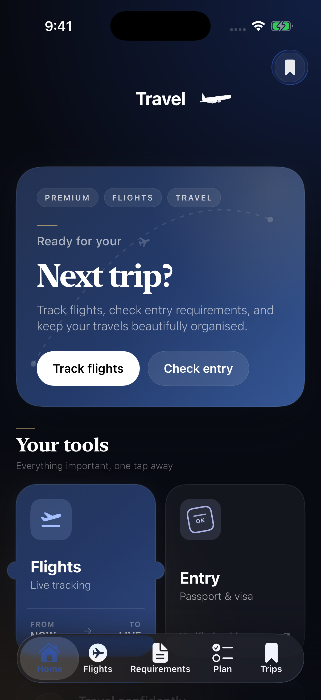

# Travel Companion

A native iOS travel-planning app that connects flight lookup, entry-requirement checks, airport information, and locally saved trips.

Swift · SwiftUI · SwiftData · Swift Concurrency · URLSession · MapKit · StoreKit 2

[](https://github.com/fayselomerahmed/travel-companion-ios/actions/workflows/build.yml)

<p></p>

Genuine iPhone simulator capture of the running app. The home screen demonstrates the interface; no live-provider responses are shown.

## The problem

Preparing a trip means combining information from several providers while keeping essential details easy to find. This project brings those tasks into one interface and treats missing configuration, provider failures, local persistence, and purchase state as explicit application states.

## Implemented

- Flight-code search, result prioritization, and flight-detail screens.
- Visa/entry-requirement lookup by passport country and destination through RapidAPI.
- Saved trips backed by SwiftData, plus recent searches stored locally.
- Airport maps, links to Apple Maps, and direct official-airport links. Experimental Frankfurt HTML enrichment is disabled by default.
- Interface resources for 22 languages and an in-app language selector.
- StoreKit 2 product loading, verified entitlement handling, and purchase restoration. Unfinished upsell sections are hidden and purchases remain disabled by default.

## Engineering highlights

**Feature state separated from provider requests.** Main-actor [flight](TravelCompanion/Features/Flights/FlightViewModel.swift) and [requirements](TravelCompanion/Features/Requirements/RequirmentsViewModel.swift) view models own loading, results, and errors. Provider-specific services handle requests and decoding through the shared [API client](TravelCompanion/Networking/APIClient.swift).

**Search results stay tied to the active request.** Older flight responses cannot replace newer results. Changing a nationality/destination selection or clearing results invalidates an in-flight requirements check; cancellation does not trigger a retry or an error banner.

**Defensive configuration and persistence.** [ConfigurationPolicy](TravelCompanion/Networking/ConfigurationPolicy.swift) rejects placeholders and unresolved build variables. Requests have bounded timeouts and user-facing failures. If the persistent store cannot open, [startup](TravelCompanion/TravelCompanionApp.swift) shows a recovery screen instead of pretending in-memory trips were permanently saved.

**Purchase access follows verified state.** The [purchase manager](TravelCompanion/SharedUI/PurchaseManager.swift) refreshes current entitlements after transaction updates and excludes revoked, expired, or upgraded purchases. Unfinished premium upsells are hidden by default. Purchases require an explicit build opt-in after the capabilities and payment flows are verified.

The provider fallback is deliberately bounded: flight search retries once without a date only for an empty dated result or a recognized subscription restriction. Missing keys, authorization/quota errors, transport failures, and decoding errors do not trigger a second request. Superseded searches also skip fallback and enrichment work. Frankfurt HTML enrichment requires an explicit `ExperimentalFrankfurtHTMLEnrichmentEnabled` opt-in; the default build keeps provider flight data, maps, and direct official-airport links without relying on scraped status matches.

## Verified build and tests

The [verified CI run](https://github.com/fayselomerahmed/travel-companion-ios/actions/runs/39072936112) at `b869c4d` passed a complete Release iOS simulator build and **20 regression tests** on 2026-10-18 (Europe/Berlin). Tests cover configuration, entitlement policy, explicit airport-enrichment opt-in, out-of-order searches, cancellation, selection/reset invalidation, mismatched provider routes, safe provider errors, and bounded date fallback without unnecessary permanent-error retries.

```bash
swift test
```

These tests exercise configuration, entitlement policy, and real view-model state using controlled services; they are not live-provider integration or full UI tests. The [CI configuration](.github/workflows/build.yml) includes the exact Release build command.

Documentation-only pushes skip the app rebuild; pull requests and manual runs still execute all build checks. Secret scans remain active for every push.

## Run locally

Use Xcode 26.4 (the verified CI toolchain); the app's deployment target is iOS 17.

```bash
git clone https://github.com/fayselomerahmed/travel-companion-ios.git
cd travel-companion-ios
cp Secrets.example.xcconfig Secrets.local.xcconfig
open TravelCompanion.xcodeproj
```

Add your RapidAPI visa-service key and Aviationstack key to the ignored `Secrets.local.xcconfig`, then select the `TravelCompanion` scheme and an iPhone simulator. The app builds without keys; API-backed screens report missing configuration until valid credentials are supplied. Physical-device builds require your own signing team.

`Secrets.xcconfig` supplies empty defaults and imports the local file optionally. Never commit local credentials. Reusable paid-provider keys must move behind a controlled backend before public distribution; an app bundle cannot keep them secret.

## Release scope

This portfolio project has a verified simulator build, not a production-service or App Store release claim. Live-provider/device checks, privacy declarations, and distribution requirements are tracked in [release readiness](PRODUCTION_READINESS.md). Live alerts, a document wallet, and premium offline tools remain planned and are not sold as completed features. Entry requirements must be confirmed with official destination authorities.

[Feature screens](TravelCompanion/Features) · [API models](TravelCompanion/Models) · [Networking](TravelCompanion/Networking) · [Shared UI](TravelCompanion/SharedUI) · [Security](SECURITY.md)
